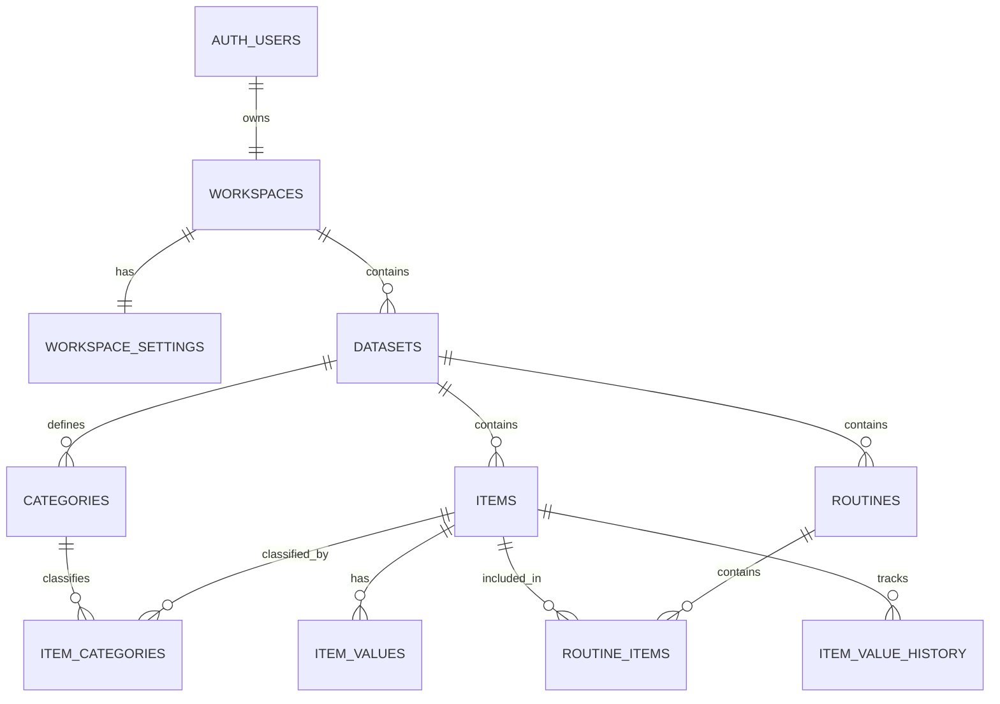

# Sift Database Schema

**Status:** Initial schema designed; migration committed but not yet applied to a Supabase project.

Migration: `supabase/migrations/20261118190000_initial_schema.sql`

## 1. Entity relationships

Each Auth user receives one private workspace. The workspace receives a default Gym dataset and a settings row when the account is created.

## 2. Tables

| Table | Purpose |
|---|---|
| `workspaces` | User ownership boundary; one owner per workspace |
| `workspace_settings` | Preferred weight display unit (`kg` or `lb`) |
| `datasets` | Reusable collections, initially seeded with `gym` |
| `items` | Generic records; gym items are exercises |
| `categories` | User-defined labels such as muscle groups |
| `item_categories` | Many-to-many item/category links |
| `routines` | Named, reusable exercise collections |
| `routine_items` | Ordered exercise links within routines |
| `item_values` | Current named numeric values for an item |
| `item_value_history` | Dated snapshots of value changes |

### Important columns and rules

- `items.attributes` is JSONB for optional domain-specific metadata.
- `items.is_favorite` stores the simple exercise preference.
- `items.archived_at` marks an archived record. Archiving does not delete its history or routine links.
- `routine_items.position` controls exercise order. Position values must be unique within a routine.
- An exercise can belong to multiple routines and categories.
- Composite foreign keys ensure that routines, items and categories linked together belong to the same dataset.
- Archived items cannot be newly added to routines. Existing links are preserved.

## 3. Weight storage and history

The preferred unit is stored per workspace in `workspace_settings.preferred_weight_unit`.

For the `current_weight` value key:

- Store the numeric value in kilograms, regardless of the user's preferred display unit.
- When a user enters pounds, convert the input to kilograms before writing to Supabase.
- Display kilograms directly or convert the stored value to pounds according to the preference.
- The database check constraint requires `unit = 'kg'` and a non-negative value for `current_weight`.

A database trigger appends a row to `item_value_history` whenever a current value is inserted or its numeric value/unit changes. The history stores the canonical value, timestamp and authenticated user ID. A no-op update does not create a duplicate history entry.

Historical rows can be corrected or deleted by their owner. Changing the current value and its history snapshot happens in the same database transaction because the history write is performed by a trigger.

## 4. Authentication and account provisioning

An `auth.users` insert trigger automatically creates:

1. A workspace owned by the new user.
2. A workspace settings row with the default preferred unit `kg`.
3. A dataset with key `gym`, name `Gym` and domain `gym`.

The frontend must not create a second workspace or Gym dataset during signup.

## 5. Row Level Security

RLS is enabled on every application table in the migration. Authenticated users can access rows only when the owning workspace belongs to their Auth user ID. Anonymous access is revoked.

Exercise deletion is not granted to authenticated users; the product operation is archive/restore via `archived_at`. Existing routine links and weight history remain intact when an exercise is archived.

## 6. Applying the migration

This migration has been committed to the repository but has **not** been applied to a live Supabase project.

1. Install the Supabase CLI and sign in.
2. From the repository root, link the project with its Supabase project reference.
3. Review the linked project and ensure it is the intended development project.
4. Run `supabase db push` to apply the migration.
5. Verify the tables, RLS policies and signup trigger in the Supabase dashboard.
6. Create a test account and confirm that it receives a private workspace and Gym dataset.

Do not put the database password, access token or service-role key in Git or frontend environment variables. Do not run this migration against a production project until it has been tested in development.

## 7. Follow-up implementation work

- Generate TypeScript database types from the applied schema.
- Add automated database/RLS tests using two separate test users.
- Add a UI/service operation for converting lb input to canonical kg.
- Add a UI for editing and deleting an incorrect historical weight entry.
- Add archive/restore controls for exercises.
- Decide whether the workspace display name should be editable in the first UI release.
